# Predictive Maintenance for Trucks and Engines

**Live dashboard:** https://machine-failure-prediction-qtiboudvxvhpybkv8hgttk.streamlit.app

Predicts which vehicles are close to a component failure and decides which ones
to call in for a workshop check, by expected cost rather than accuracy. The main
case is Scania Component X, real operational data from a fleet of trucks, scored
with the cost matrix Scania defined: a late or missed failure costs 200 to 500,
an unneeded check 7 to 10. NASA's simulated C-MAPSS turbofan data is a second
benchmark, where the alarm is replayed over each engine's whole life.

Models, calibration and decision rules are chosen on training and validation
data only; each test set is scored once. Every result below is generated from
the saved reports, including results where a method does not win.

## Scania Component X

### Problem

Each vehicle sends periodic readouts from an anonymised engine component. For
the latest readout of a validation or test vehicle, predict how soon the
component needs repair:

| Class | Time steps before failure |
|---|---|
| 0 | more than 48 |
| 1 | 48 to 24 |
| 2 | 24 to 12 |
| 3 | 12 to 6 |
| 4 | 6 to 0 |

Every window includes its upper edge (48 is class 1, 24 is class 2, 12 is
class 3, 6 is class 4), because class 0 is defined as more than 48.

### Data

- **Readouts**: 14 anonymised variables per readout, 8 counters and 6
  histograms, 105 values in all. Every variable is a running total that never
  decreases.
- **Specifications**: 8 categorical columns per vehicle.
- **Training outcome**: the length of each vehicle's study period and whether
  the component was repaired at its end.
- **Validation and test labels**: one class per vehicle for its last readout.
  Scania cut these vehicles' readouts at a random point, so only a small
  share of them are in classes 1 to 4.

### Labels and censoring

For a training readout, time left = study length − time step. For repaired
vehicles this is exact. For vehicles that were not repaired, the failure, if
any, comes after the study ended, so the true time left is at least this
number: above 48 the readout is class 0, and otherwise its class is unknown.

- The **five-class model** drops readouts whose class is unknown.
- The **horizon models** ask "will this vehicle fail within 6, 12, 24 or 48
  steps?" separately. A censored readout is a known negative for every horizon
  shorter than its time left, so they keep most of the readouts the five-class
  labels drop. Their cumulative probabilities are made non-decreasing and then
  turned into class probabilities.

### Features

One row per readout, built only from that vehicle's readouts up to and
including it:

- time step and number of readouts so far
- each counter's value and its rate of change over the last 5 readouts
- each histogram's bin shares, total count and change in bin shares over the
  last 5 readouts
- specifications as one-hot columns learned from training vehicles
- optional groups, kept only when they lower the evaluation cost: usage
  intensity (totals per time step), rates over the last 10 readouts, and
  counter intensity relative to vehicles with the same Spec_0

Missing values stay missing for gradient boosting; logistic regression imputes
training medians. Validation and test vehicles get one row each, built from all
their readouts.

### Evaluation sets

The official validation set has few at-risk vehicles, so methods are also
compared on a **simulated validation set** built from training vehicles the way
the official sets were made: each vehicle is cut at one seeded random readout,
features use only readouts up to that point, and predictions are out-of-fold
from 5 vehicle-grouped folds. Candidates are chosen by cost on the simulated
set and checked on the official set.

### Decisions and calibration

The official cost is the sum over vehicles of `cost[true class][predicted class]`:

| True \ predicted | 0 | 1 | 2 | 3 | 4 |
|---|---|---|---|---|---|
| 0 | 0 | 7 | 8 | 9 | 10 |
| 1 | 200 | 0 | 7 | 8 | 9 |
| 2 | 300 | 200 | 0 | 7 | 8 |
| 3 | 400 | 300 | 200 | 0 | 7 |
| 4 | 500 | 400 | 300 | 200 | 0 |

- **Lowest expected cost**: each vehicle gets the class m that minimises
  Σₙ P(class n) × cost[n][m]. Because a check is so much cheaper than a miss,
  this flags any vehicle with a small risk.
- **Calibration**: a prior-shift correction with fixed class weights (class
  share in the simulated validation set ÷ class share in the training rows),
  optionally followed by isotonic calibration of the at-risk probability fitted
  on out-of-fold training predictions. Class weights searched on the official
  validation set are reported as a comparison only.
- **Workshop capacity**: the cost matrix assumes every flagged vehicle can be
  inspected. With a capacity of k%, only the riskiest k% of vehicles (by
  probability of failing within 48 steps) are flagged, each with the class 1-4
  of lowest expected cost. The recommended capacity is the smallest one whose
  simulated-validation cost is within 5% of the unconstrained cost.

The test set is scored once, with 1,000-resample bootstrap intervals for cost,
for the saving against always predicting class 0, and for the difference
between models.

### Results

Generated by `python -m mfp.scania.pipeline` from `reports/scania/`.

<!-- SCANIA:START -->
Training data: 919,304 labelled readouts from 23,549 vehicles for the five-class model; the horizon models also use censored readouts where their horizon is known. Simulated validation set: 18,622 training vehicles cut at a random readout (648 at risk), predicted out-of-fold. Official validation: 5,046 vehicles (136 at risk). Test: 5,045 vehicles (142 at risk).

#### Model selection

Every candidate was scored on both evaluation sets with lowest-expected-cost decisions. Candidates were compared on a seeded 40% of training rows; the chosen model was then trained on all rows. Each candidate is shown with its calibration that has the lowest simulated cost (calibrations searched on the official validation set are excluded from the choice).

| Candidate | Calibration | Sim. PR-AUC | Sim. ROC-AUC | Sim. Brier | Sim. cost | Sim. healthy flagged | Sim. recall | Val. PR-AUC | Val. ROC-AUC | Val. Brier | Val. cost | Val. healthy flagged | Val. recall |
|---|---|---|---|---|---|---|---|---|---|---|---|---|---|
| 5-class GB · unweighted · base | prior shift + isotonic | 0.154 | 0.816 | 0.0313 | 96,397 | 27.4% | 75.6% | 0.057 | 0.669 | 0.0343 | 44,394 | 77.3% | 91.9% |
| horizons GB · unweighted · base+intensity | prior shift + isotonic | 0.150 | 0.821 | 0.0313 | 99,668 | 31.5% | 78.5% | 0.059 | 0.676 | 0.0353 | 47,118 | 84.2% | 95.6% |
| horizons GB · vehicle-weighted · base | prior shift + isotonic | 0.160 | 0.823 | 0.0312 | 99,897 | 31.3% | 80.7% | 0.081 | 0.732 | 0.0306 | 43,346 | 75.5% | 95.6% |
| horizons GB · unweighted · base+intensity+rate10 | prior shift + isotonic | 0.152 | 0.819 | 0.0313 | 100,933 | 30.9% | 78.5% | 0.054 | 0.678 | 0.0385 | 45,230 | 85.2% | 98.5% |
| horizons GB · unweighted · base+intensity+rate10+fleet | prior shift | 0.150 | 0.825 | 0.0327 | 101,759 | 21.7% | 69.0% | 0.062 | 0.674 | 0.0472 | 41,557 | 71.9% | 89.7% |
| horizons GB · unweighted · base | prior shift | 0.153 | 0.825 | 0.0325 | 102,454 | 21.9% | 68.5% | 0.061 | 0.680 | 0.0395 | 42,671 | 69.8% | 88.2% |
| horizons LR · unweighted · base+intensity+rate10 | prior shift + isotonic | 0.119 | 0.785 | 0.0320 | 106,255 | 29.9% | 73.5% | 0.054 | 0.667 | 0.0300 | 46,300 | 68.7% | 86.8% |
| 5-class LR · unweighted · base | prior shift + isotonic | 0.119 | 0.785 | 0.0320 | 108,442 | 32.1% | 74.5% | 0.046 | 0.629 | 0.0288 | 44,225 | 62.8% | 80.9% |

<details>
<summary>Every candidate with every calibration</summary>

| Candidate | Calibration | Sim. PR-AUC | Sim. ROC-AUC | Sim. Brier | Sim. cost | Sim. healthy flagged | Sim. recall | Val. PR-AUC | Val. ROC-AUC | Val. Brier | Val. cost | Val. healthy flagged | Val. recall |
|---|---|---|---|---|---|---|---|---|---|---|---|---|---|
| 5-class GB · unweighted · base | none | 0.160 | 0.821 | 0.0320 | 103,819 | 17.8% | 62.5% | 0.053 | 0.676 | 0.0354 | 41,873 | 60.9% | 83.1% |
| 5-class GB · unweighted · base | prior shift | 0.159 | 0.821 | 0.0319 | 97,005 | 22.0% | 69.9% | 0.054 | 0.675 | 0.0390 | 43,390 | 69.6% | 89.0% |
| 5-class GB · unweighted · base | prior shift + isotonic | 0.154 | 0.816 | 0.0313 | 96,397 | 27.4% | 75.6% | 0.057 | 0.669 | 0.0343 | 44,394 | 77.3% | 91.9% |
| 5-class GB · unweighted · base | searched on validation | 0.156 | 0.819 | 0.0324 | 109,602 | 15.4% | 56.0% | 0.053 | 0.672 | 0.0342 | 38,840 | 55.3% | 80.1% |
| 5-class LR · unweighted · base | none | 0.123 | 0.791 | 0.0326 | 111,852 | 18.5% | 59.1% | 0.048 | 0.633 | 0.0287 | 44,873 | 43.5% | 60.3% |
| 5-class LR · unweighted · base | prior shift | 0.123 | 0.791 | 0.0327 | 108,644 | 23.2% | 65.6% | 0.048 | 0.632 | 0.0303 | 43,449 | 49.7% | 69.9% |
| 5-class LR · unweighted · base | prior shift + isotonic | 0.119 | 0.785 | 0.0320 | 108,442 | 32.1% | 74.5% | 0.046 | 0.629 | 0.0288 | 44,225 | 62.8% | 80.9% |
| 5-class LR · unweighted · base | searched on validation | 0.124 | 0.791 | 0.0328 | 108,777 | 27.4% | 69.9% | 0.046 | 0.633 | 0.0328 | 42,101 | 54.9% | 75.7% |
| horizons GB · vehicle-weighted · base | none | 0.164 | 0.827 | 0.0316 | 105,601 | 22.4% | 69.1% | 0.081 | 0.724 | 0.0325 | 40,713 | 62.1% | 89.0% |
| horizons GB · vehicle-weighted · base | prior shift | 0.165 | 0.827 | 0.0316 | 105,720 | 22.4% | 68.8% | 0.082 | 0.727 | 0.0324 | 40,707 | 62.5% | 89.0% |
| horizons GB · vehicle-weighted · base | prior shift + isotonic | 0.160 | 0.823 | 0.0312 | 99,897 | 31.3% | 80.7% | 0.081 | 0.732 | 0.0306 | 43,346 | 75.5% | 95.6% |
| horizons GB · vehicle-weighted · base | searched on validation | 0.154 | 0.822 | 0.0329 | 119,711 | 11.0% | 47.4% | 0.074 | 0.731 | 0.0290 | 33,432 | 42.7% | 77.9% |
| horizons GB · unweighted · base | none | 0.153 | 0.825 | 0.0324 | 105,427 | 17.9% | 63.4% | 0.061 | 0.679 | 0.0358 | 41,470 | 61.7% | 86.0% |
| horizons GB · unweighted · base | prior shift | 0.153 | 0.825 | 0.0325 | 102,454 | 21.9% | 68.5% | 0.061 | 0.680 | 0.0395 | 42,671 | 69.8% | 88.2% |
| horizons GB · unweighted · base | prior shift + isotonic | 0.142 | 0.818 | 0.0314 | 103,075 | 36.8% | 83.3% | 0.062 | 0.682 | 0.0335 | 47,231 | 87.6% | 97.8% |
| horizons GB · unweighted · base | searched on validation | 0.148 | 0.820 | 0.0331 | 111,059 | 14.0% | 54.5% | 0.068 | 0.694 | 0.0330 | 37,013 | 51.2% | 80.1% |
| horizons GB · unweighted · base+intensity | none | 0.155 | 0.825 | 0.0320 | 107,873 | 17.6% | 62.5% | 0.064 | 0.674 | 0.0409 | 42,415 | 63.4% | 86.8% |
| horizons GB · unweighted · base+intensity | prior shift | 0.155 | 0.826 | 0.0321 | 102,195 | 21.6% | 68.7% | 0.065 | 0.675 | 0.0460 | 42,862 | 70.4% | 90.4% |
| horizons GB · unweighted · base+intensity | prior shift + isotonic | 0.150 | 0.821 | 0.0313 | 99,668 | 31.5% | 78.5% | 0.059 | 0.676 | 0.0353 | 47,118 | 84.2% | 95.6% |
| horizons GB · unweighted · base+intensity | searched on validation | 0.151 | 0.823 | 0.0325 | 114,271 | 12.7% | 52.2% | 0.063 | 0.682 | 0.0340 | 36,724 | 53.5% | 81.6% |
| horizons GB · unweighted · base+intensity+rate10 | none | 0.158 | 0.826 | 0.0319 | 106,730 | 17.3% | 63.0% | 0.055 | 0.680 | 0.0484 | 41,621 | 67.3% | 90.4% |
| horizons GB · unweighted · base+intensity+rate10 | prior shift | 0.159 | 0.826 | 0.0320 | 101,233 | 21.4% | 68.5% | 0.056 | 0.682 | 0.0549 | 42,100 | 74.7% | 93.4% |
| horizons GB · unweighted · base+intensity+rate10 | prior shift + isotonic | 0.152 | 0.819 | 0.0313 | 100,933 | 30.9% | 78.5% | 0.054 | 0.678 | 0.0385 | 45,230 | 85.2% | 98.5% |
| horizons GB · unweighted · base+intensity+rate10 | searched on validation | 0.155 | 0.824 | 0.0327 | 118,172 | 10.3% | 47.2% | 0.051 | 0.682 | 0.0476 | 36,020 | 51.9% | 81.6% |
| horizons GB · unweighted · base+intensity+rate10+fleet | none | 0.149 | 0.824 | 0.0326 | 107,225 | 17.6% | 63.1% | 0.062 | 0.672 | 0.0421 | 39,919 | 64.0% | 85.3% |
| horizons GB · unweighted · base+intensity+rate10+fleet | prior shift | 0.150 | 0.825 | 0.0327 | 101,759 | 21.7% | 69.0% | 0.062 | 0.674 | 0.0472 | 41,557 | 71.9% | 89.7% |
| horizons GB · unweighted · base+intensity+rate10+fleet | prior shift + isotonic | 0.145 | 0.818 | 0.0314 | 102,593 | 34.9% | 82.1% | 0.058 | 0.674 | 0.0345 | 44,761 | 88.0% | 98.5% |
| horizons GB · unweighted · base+intensity+rate10+fleet | searched on validation | 0.149 | 0.823 | 0.0334 | 122,238 | 9.5% | 44.1% | 0.056 | 0.681 | 0.0431 | 35,999 | 51.4% | 80.1% |
| horizons LR · unweighted · base+intensity+rate10 | none | 0.126 | 0.791 | 0.0326 | 114,299 | 18.0% | 58.0% | 0.061 | 0.666 | 0.0300 | 45,032 | 52.2% | 75.0% |
| horizons LR · unweighted · base+intensity+rate10 | prior shift | 0.126 | 0.791 | 0.0326 | 108,403 | 22.4% | 65.0% | 0.060 | 0.667 | 0.0326 | 44,752 | 59.5% | 80.9% |
| horizons LR · unweighted · base+intensity+rate10 | prior shift + isotonic | 0.119 | 0.785 | 0.0320 | 106,255 | 29.9% | 73.5% | 0.054 | 0.667 | 0.0300 | 46,300 | 68.7% | 86.8% |
| horizons LR · unweighted · base+intensity+rate10 | searched on validation | 0.128 | 0.788 | 0.0326 | 108,406 | 25.0% | 66.7% | 0.060 | 0.655 | 0.0287 | 39,376 | 51.0% | 75.7% |

</details>

Changes tried on the horizon gradient boosting model (simulated cost): vehicle weights: not kept (102,454 → 105,720); features: intensity: kept (102,454 → 102,195); features: rate10: kept (102,195 → 101,233); features: fleet: not kept (101,233 → 101,759).

Chosen: **5-class GB · unweighted · base** with **prior shift + isotonic** calibration (simulated cost 99,302, official validation cost 42,339). The official validation set prefers horizons GB · unweighted · base+intensity+rate10+fleet with none calibration (cost 39,919); the simulated set has 3.7 times as many vehicles, so it decides.
The horizon models did not beat the five-class model on simulated cost, so the five-class model is the headline.

#### Workshop capacity

The official cost matrix assumes unlimited workshop capacity. With a capacity of k%, only the riskiest k% of vehicles (by probability of failing within 48 steps) may be flagged; each gets the class 1-4 with the lowest expected cost, the rest class 0. Chosen model:

| Capacity | Sim. cost | Sim. recall | Sim. healthy flagged | Val. cost | Val. recall | Val. healthy flagged |
|---|---|---|---|---|---|---|
| unlimited | 99,302 | 78.4% | 32.0% | 42,339 | 94.9% | 78.6% |
| 2% capacity | 167,866 | 13.6% | 1.6% | 54,299 | 6.6% | 1.9% |
| 5% capacity | 142,045 | 28.4% | 4.2% | 51,506 | 13.2% | 4.8% |
| 10% capacity | 124,585 | 42.1% | 8.8% | 47,521 | 24.3% | 9.6% |
| 20% capacity | 103,487 | 62.3% | 18.5% | 40,343 | 44.9% | 19.3% |

Recommended operating point: **20% capacity**, the smallest capacity with cost within 5% of the unconstrained cost (103,487 vs 99,302) on the simulated validation set.

#### Test set (scored once)

95% intervals from 1,000 bootstrap resamples of test vehicles.

| Model | Capacity | Official cost (95% interval) | Saving vs always class 0 (95% interval) | Recall | Precision | False alarms | Healthy flagged | Macro F1 |
|---|---|---|---|---|---|---|---|---|
| Always class 0 | - | 56,100 [47,800, 65,302] | - | 0.0% | n/a | 0 | 0.0% | 0.197 |
| Gradient boosting | unlimited | 43,536 [40,765, 46,402] | 12,564 [4,222, 21,243] | 93.0% | 3.4% | 3,762 | 76.7% | 0.085 |
| Gradient boosting | 2% capacity | 52,280 [44,122, 61,306] | 3,820 [1,312, 6,751] | 8.5% | 11.9% | 89 | 1.8% | 0.213 |
| Gradient boosting | 5% capacity | 50,213 [42,455, 58,894] | 5,887 [2,564, 9,797] | 15.5% | 8.7% | 230 | 4.7% | 0.209 |
| Gradient boosting | 10% capacity | 46,026 [38,652, 54,456] | 10,074 [5,696, 14,957] | 27.5% | 7.7% | 465 | 9.5% | 0.203 |
| Gradient boosting | 20% capacity | 44,467 [37,565, 52,627] | 11,633 [6,239, 17,522] | 39.4% | 5.6% | 953 | 19.4% | 0.189 |
| Logistic regression | unlimited | 43,756 [40,234, 47,713] | 12,344 [4,564, 21,012] | 87.3% | 3.5% | 3,385 | 69.0% | 0.106 |
| Logistic regression | 2% capacity | 53,254 [45,074, 61,869] | 2,846 [624, 5,194] | 7.0% | 9.9% | 91 | 1.9% | 0.206 |
| Logistic regression | 5% capacity | 50,702 [42,669, 59,362] | 5,398 [2,112, 9,271] | 13.4% | 7.5% | 233 | 4.8% | 0.204 |
| Logistic regression | 10% capacity | 46,314 [38,879, 54,601] | 9,786 [5,239, 14,976] | 26.8% | 7.5% | 466 | 9.5% | 0.205 |
| Logistic regression | 20% capacity | 44,002 [36,962, 51,954] | 12,098 [6,589, 18,302] | 40.1% | 5.6% | 952 | 19.4% | 0.194 |
| Searched correction | unlimited | 42,594 [37,506, 47,894] | 13,506 [6,169, 21,329] | 66.9% | 3.9% | 2,359 | 48.1% | 0.147 |
| Searched correction | 2% capacity | 52,521 [44,300, 61,471] | 3,579 [1,076, 6,428] | 7.7% | 10.9% | 90 | 1.8% | 0.209 |
| Searched correction | 5% capacity | 48,829 [41,129, 57,371] | 7,271 [3,457, 11,264] | 17.6% | 9.9% | 227 | 4.6% | 0.212 |
| Searched correction | 10% capacity | 46,481 [39,142, 54,884] | 9,619 [5,135, 14,534] | 26.8% | 7.5% | 466 | 9.5% | 0.203 |
| Searched correction | 20% capacity | 45,030 [38,051, 52,877] | 11,070 [5,465, 16,769] | 38.0% | 5.4% | 955 | 19.5% | 0.190 |

Always class 0 has a higher macro F1 than the models because it is right about almost every healthy vehicle, and macro F1 does not price mistakes; the official cost does, and it is the metric that matters here.

In plain words:

- With unlimited capacity, the chosen model costs 43,536 against 42,594 for the searched-correction model and 56,100 for always class 0. The difference from the searched-correction model is not clear: the 95% interval includes zero ([-4,850, 3,610]).
- At the recommended 20% capacity, it flags 953 healthy vehicles (19.4%) instead of 2,359 (48.1%) for the searched-correction model with unlimited capacity, and keeps 93% of the unlimited-capacity saving against always class 0 (cost 44,467; recall 39.4%).

Test confusion matrix of the chosen model at 20% capacity (rows: true class, columns: predicted class):

| True \ predicted | 0 | 1 | 2 | 3 | 4 |
|---|---|---|---|---|---|
| 0 | 3,950 | 4 | 29 | 51 | 869 |
| 1 | 15 | 0 | 0 | 1 | 10 |
| 2 | 9 | 0 | 0 | 0 | 6 |
| 3 | 23 | 0 | 1 | 1 | 16 |
| 4 | 39 | 0 | 0 | 1 | 20 |

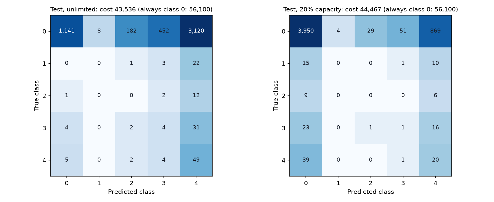

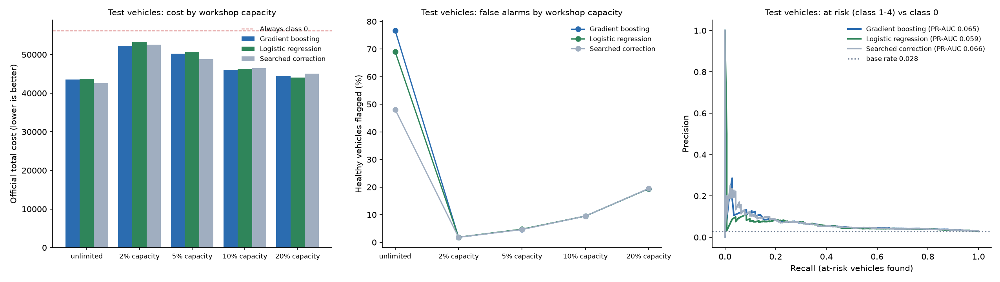
<!-- SCANIA:END -->

### What drives the predictions

SHAP splits each vehicle's prediction into one contribution per feature;
positive values push the risk up, negative values push it down.

<!-- SCANIA_SHAP:START -->
Method: shap.TreeExplainer per class, combined through the softmax, explaining the log-odds of being at risk (classes 1-4), after the prior shift, for all 5,045 test vehicles. Largest gap between a vehicle's contributions plus the base value and its model output: 2.3e-13.

| Rank | All test vehicles | Mean \|SHAP\| | Vehicles flagged at 20% capacity (1,009) | Mean \|SHAP\| |
|---|---|---|---|---|
| 1 | Time step | 3.198 | Time step | 3.811 |
| 2 | Histogram 167, bin 5: share of total | 0.988 | Histogram 167, bin 5: share of total | 1.363 |
| 3 | Histogram 459: total count | 0.746 | Histogram 459: total count | 0.973 |
| 4 | Histogram 158, bin 2: change in share of total (last 5 readouts) | 0.555 | Histogram 158, bin 2: change in share of total (last 5 readouts) | 0.772 |
| 5 | Histogram 291, bin 2: share of total | 0.555 | Histogram 291, bin 2: share of total | 0.718 |
| 6 | Histogram 459, bin 13: share of total | 0.512 | Histogram 459, bin 13: share of total | 0.673 |
| 7 | Histogram 459, bin 4: change in share of total (last 5 readouts) | 0.477 | Histogram 459, bin 4: change in share of total (last 5 readouts) | 0.590 |
| 8 | Counter 666: value | 0.283 | Counter 666: value | 0.308 |
| 9 | Histogram 291, bin 5: share of total | 0.223 | Histogram 397, bin 16: share of total | 0.230 |
| 10 | Histogram 397, bin 16: share of total | 0.217 | Histogram 291: total count | 0.184 |

Mean |SHAP| is in log-odds of being at risk. SHAP shows what the model relies on, not what causes failures; the variables are anonymised.

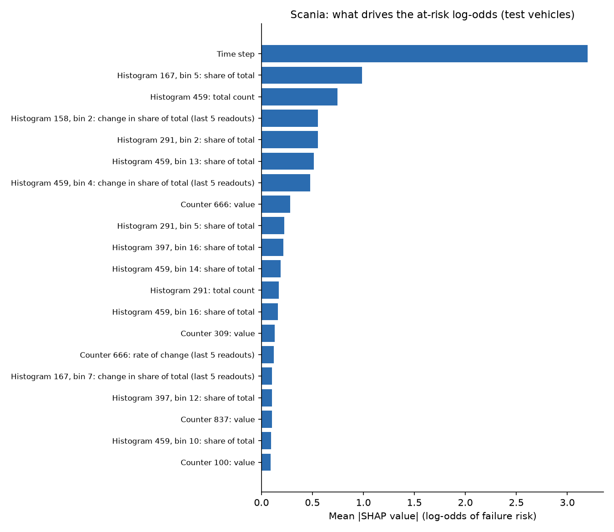
<!-- SCANIA_SHAP:END -->

### Limitations

- **The at-risk signal is weak.** Most of the saving against always class 0
  comes from flagging many vehicles, because a check is much cheaper than a
  miss. Precision is low at every capacity.
- **Classes 1 to 3 are rarely predicted.** The cost structure makes class 4 the
  cheapest way to flag any risk.
- **The simulated validation set is easier than the official sets.** Its
  ranking scores are higher and its at-risk class mix differs, so choices made
  on it may not carry over in full.
- **Vehicle age dominates the explanations.** In training, late readouts of
  healthy vehicles are the ones censoring removes, which makes age look like
  risk.
- **Explanations describe the model, not causes.** The variables are
  anonymised, so a feature's importance does not say what it measures.
- One seed and one run; variation across seeds is not measured.

## NASA C-MAPSS benchmark

Simulated turbofan engines in four subsets; FD002 and FD004 fly under six
operating conditions. Training engines run to failure, so the alarm is replayed
over each engine's life. It rings once, when the probability of failing within
30 cycles has stayed at or above a threshold for 1, 2 or 3 consecutive cycles.

- **Good catch**: rings 10 to 50 cycles before failure.
- **Early alarm**: rings earlier; the check is wasted.
- **Missed**: never rings, or rings fewer than 10 cycles before failure.

Lifecycle cost = 10 × missed + early alarms. The 10:1 ratio and the warning
window are assumptions; 5:1, 20:1 and minimum warnings of 20 and 30 cycles are
reported as well.

Training engines are split by whole engine into fit (60%), validation (20%) and
lifecycle test (20%) sets. Sensors are z-scored per operating regime, with
regimes and statistics learned from fit engines. Features are past-only rolling
means, standard deviations and trends over 10 cycles. Gradient boosting and
logistic regression each get an alarm policy chosen on validation engines and
are then replayed on lifecycle test engines next to two fixed rules: a 0.5
threshold that rings at once, and a 0.5 threshold with the chosen policy's
confirm cycles. The NASA test engines stop before failure and give the standard
benchmark: PR-AUC, precision, recall and false alarms at the last recorded
cycle, and remaining-life RMSE and NASA score for a gradient boosting regressor
and a ridge baseline.

The NASA score adds, per engine, e^(−d/13) − 1 when the predicted life is too
short (d < 0) and e^(d/10) − 1 when it is too long, with d = predicted − true.
Lower is better.

<!-- RESULTS:START -->
**Required warning time.** Lifecycle test cost, cost-based policy / fixed 0.5 threshold, each judged with that warning window:

| Subset | At least 10 cycles | At least 20 cycles | At least 30 cycles |
|---|---|---|---|
| FD001 | 1 / 1 | 4 / 41 | 19 / 131 |
| FD002 | 3 / 3 | 20 / 63 | 40 / 283 |
| FD003 | 1 / 1 | 3 / 31 | 18 / 121 |
| FD004 | 4 / 6 | 17 / 16 | 43 / 176 |

When at least 20 or 30 cycles of warning are required, the cost-based policy is cheaper than a fixed 0.5 threshold in 7 of 8 cases; the exception is FD004 at 20 cycles (17 vs 16). A fixed 0.5 threshold rings too late once more warning is needed, while the cost-based threshold is re-chosen on validation engines for each window.

At the default 10-cycle window the picture is different. Cost of the cost-based policy / fixed 0.5 / fixed 0.5 with the same confirm cycles: FD001: 1 / 1 / 0; FD002: 3 / 3 / 3; FD003: 1 / 1 / 0; FD004: 4 / 6 / 4. Wherever the cost-based policy beats fixed 0.5, fixed 0.5 with the same confirm cycles does as well or better, so the gain comes from confirming over several cycles, not from the threshold.

Gradient boosting is the headline model on every subset; logistic regression is the baseline. Lifecycle costs assume a missed failure costs 10x an early alarm, and that an alarm is useful 10 to 50 cycles before failure. Both are assumptions. Alarm policies are always chosen on validation engines; lifecycle test and NASA test engines are used only to report results.

| Subset | Regimes | NASA test PR-AUC: boosting / logistic | RUL RMSE: boosting / ridge / naive | NASA score: boosting / ridge | Lifecycle test engines | Policy (threshold, confirm) | Lifecycle cost: cost-based / fixed 0.5 / fixed 0.5 same confirm | Logistic lifecycle cost | Cost-based beats fixed 0.5? |
|---|---|---|---|---|---|---|---|---|---|
| FD001 | 1 | 0.937 / 0.950 | 18.8 / 22.4 / 43.2 | 791 / 1,586 | 20 | 0.21, 3 | 1 / 1 / 0 | 0 | Tie |
| FD002 | 6 | 0.984 / 0.980 | 27.5 / 30.1 / 54.1 | 10,275 / 13,157 | 52 | 0.57, 1 | 3 / 3 / 3 | 1 | Tie |
| FD003 | 1 | 0.980 / 0.983 | 17.7 / 22.1 / 45.1 | 687 / 1,708 | 20 | 0.31, 3 | 1 / 1 / 0 | 1 | Tie |
| FD004 | 6 | 0.961 / 0.940 | 28.7 / 31.9 / 54.8 | 6,134 / 8,793 | 50 | 0.43, 3 | 4 / 6 / 4 | 4 | Yes |

Top three SHAP features per subset (mean |SHAP| of gradient boosting's log-odds of failure, last cycle of every NASA test engine):

| Subset | 1st | 2nd | 3rd |
|---|---|---|---|
| FD001 | Sensor 15: average (last 10 cycles) | Sensor 3: average (last 10 cycles) | Cycle number |
| FD002 | Sensor 4: average (last 10 cycles) | Sensor 11: average (last 10 cycles) | Cycle number |
| FD003 | Sensor 17: average (last 10 cycles) | Sensor 11: average (last 10 cycles) | Cycle number |
| FD004 | Sensor 11: average (last 10 cycles) | Sensor 3: average (last 10 cycles) | Cycle number |

SHAP summary charts (mean |SHAP| per feature, NASA test engines at their last cycle):

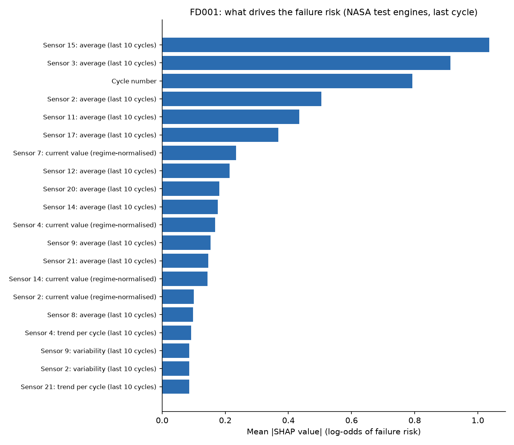
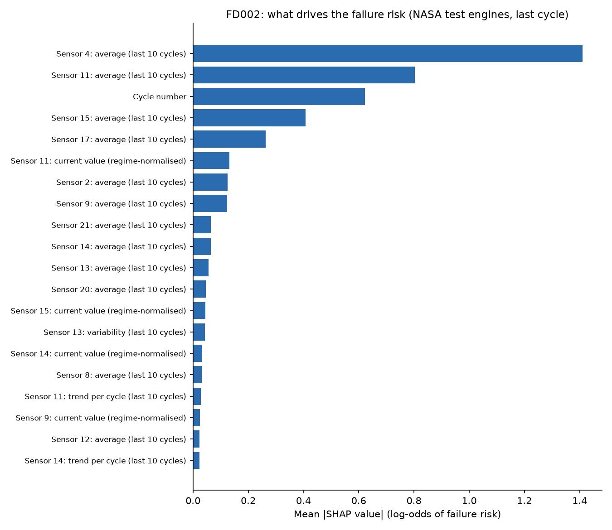
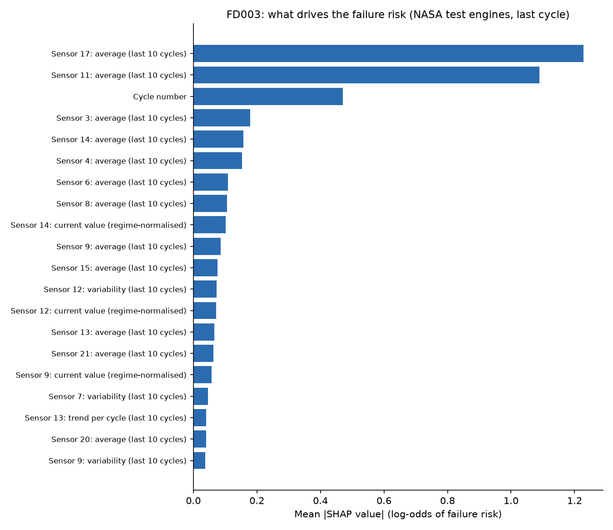
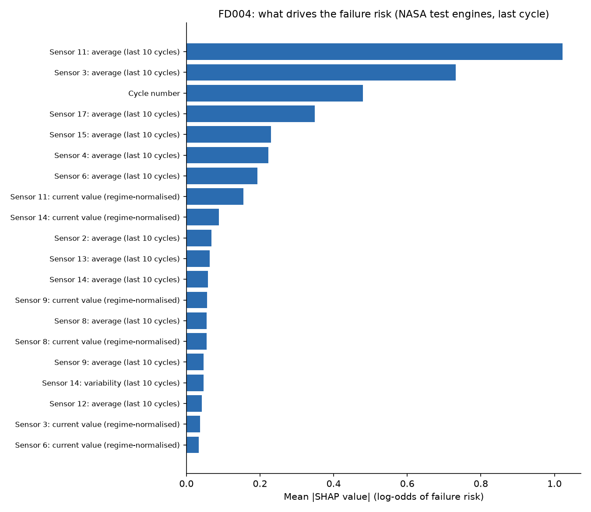

<details>
<summary>Per-subset details</summary>

### FD001 (1 operating regime)

Model: **gradient boosting**, the headline model on every subset; logistic regression is the baseline. Engines: 60 fit, 20 validation, 20 lifecycle test, 100 NASA test.

Gradient boosting vs logistic regression ("close" = within 0.01 PR-AUC or 2 cost units):

- Validation PR-AUC: 0.949 vs 0.947 (close)
- NASA test PR-AUC (last cycle): 0.937 vs 0.950 (logistic better)
- Lifecycle test cost, each with its own validation-chosen policy: 1 vs 0 (close)

Alarm policy chosen on validation engines at 10:1: ring when the failure probability is at least **0.21** for **3** consecutive cycle(s).

Lifecycle test: 20 engines run to failure. A good catch rings 10 to 50 cycles before failure. Precision = good catches / alarms that rang; early alarms are the false alarms.

| | Cost-based policy | Fixed 0.5 threshold | Fixed 0.5, same confirm cycles |
|---|---|---|---|
| Threshold | 0.21 | 0.50 | 0.50 |
| Confirm cycles | 3 | 1 | 3 |
| Good catches | 19 | 19 | 20 |
| Early alarms (false alarms) | 1 | 1 | 0 |
| Missed (never rang / too late) | 0 (0 / 0) | 0 (0 / 0) | 0 (0 / 0) |
| Precision | 0.95 | 0.95 | 1.00 |
| Cost | 1 | 1 | 0 |
| Median lead time (cycles) | 28.0 | 24.0 | 18.5 |
| Mean lead time of good catches | 26.7 | 25.6 | 22.2 |

Logistic regression baseline with its own validation-chosen policy (threshold 0.78, confirm 2): cost 0, good catches 20, early alarms 0, missed 0, precision 1.00.

Cost sensitivity (policy re-chosen on validation; cost-based vs fixed 0.5): 5:1 → 1 vs 1; 10:1 → 1 vs 1; 20:1 → 1 vs 1.

Required warning time (policy re-chosen on validation; cost-based vs fixed 0.5, each judged with that warning window): at least 10 cycles → threshold 0.21, confirm 3, cost 1 vs 1; at least 20 cycles → threshold 0.13, confirm 1, cost 4 vs 41; at least 30 cycles → threshold 0.01, confirm 1, cost 19 vs 131.

NASA test benchmark (last recorded cycle of each engine; precision / recall / false alarms):

| Model | PR-AUC (last cycle) | At its chosen threshold | At 0.5 | PR-AUC (all cycles) |
|---|---|---|---|---|
| Gradient boosting | 0.937 | 0.21: 0.91 / 0.84 / 2 | 0.95 / 0.76 / 1 | 0.788 |
| Logistic regression | 0.950 | 0.78: 0.90 / 0.76 / 2 | 0.88 / 0.88 / 3 | 0.772 |

Remaining useful life on NASA test engines (NASA score: lower is better; late predictions cost more):

| Model | RMSE (cycles) | NASA score |
|---|---|---|
| Gradient boosting | 18.8 | 791 |
| Ridge regression | 22.4 | 1,586 |
| Training mean (naive) | 43.2 | 35,630 |

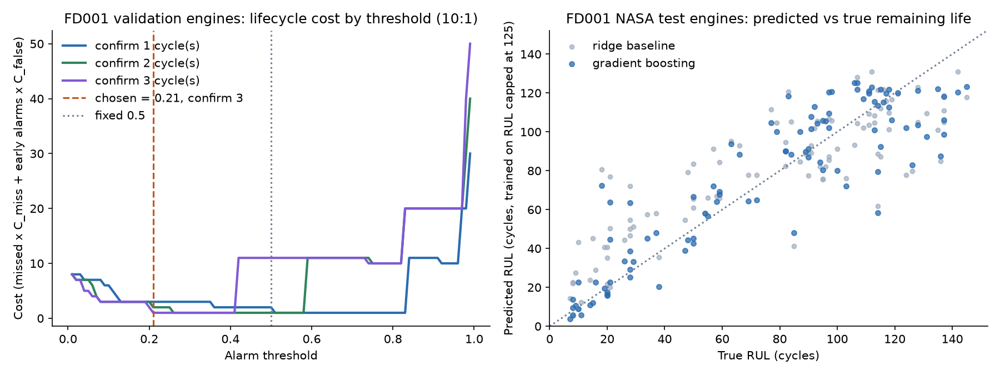

### FD002 (6 operating regimes)

Model: **gradient boosting**, the headline model on every subset; logistic regression is the baseline. Engines: 156 fit, 52 validation, 52 lifecycle test, 259 NASA test.

Gradient boosting vs logistic regression ("close" = within 0.01 PR-AUC or 2 cost units):

- Validation PR-AUC: 0.959 vs 0.960 (close)
- NASA test PR-AUC (last cycle): 0.984 vs 0.980 (close)
- Lifecycle test cost, each with its own validation-chosen policy: 3 vs 1 (logistic better)

Alarm policy chosen on validation engines at 10:1: ring when the failure probability is at least **0.57** for **1** consecutive cycle(s).

Lifecycle test: 52 engines run to failure. A good catch rings 10 to 50 cycles before failure. Precision = good catches / alarms that rang; early alarms are the false alarms.

| | Cost-based policy | Fixed 0.5 threshold | Fixed 0.5, same confirm cycles |
|---|---|---|---|
| Threshold | 0.57 | 0.50 | 0.50 |
| Confirm cycles | 1 | 1 | 1 |
| Good catches | 49 | 49 | 49 |
| Early alarms (false alarms) | 3 | 3 | 3 |
| Missed (never rang / too late) | 0 (0 / 0) | 0 (0 / 0) | 0 (0 / 0) |
| Precision | 0.94 | 0.94 | 0.94 |
| Cost | 3 | 3 | 3 |
| Median lead time (cycles) | 27.0 | 28.5 | 28.5 |
| Mean lead time of good catches | 28.3 | 29.7 | 29.7 |

Logistic regression baseline with its own validation-chosen policy (threshold 0.87, confirm 3): cost 1, good catches 51, early alarms 1, missed 0, precision 0.98.

Cost sensitivity (policy re-chosen on validation; cost-based vs fixed 0.5): 5:1 → 3 vs 3; 10:1 → 3 vs 3; 20:1 → 3 vs 3.

Required warning time (policy re-chosen on validation; cost-based vs fixed 0.5, each judged with that warning window): at least 10 cycles → threshold 0.57, confirm 1, cost 3 vs 3; at least 20 cycles → threshold 0.06, confirm 2, cost 20 vs 63; at least 30 cycles → threshold 0.01, confirm 1, cost 40 vs 283.

NASA test benchmark (last recorded cycle of each engine; precision / recall / false alarms):

| Model | PR-AUC (last cycle) | At its chosen threshold | At 0.5 | PR-AUC (all cycles) |
|---|---|---|---|---|
| Gradient boosting | 0.984 | 0.57: 0.92 / 0.95 / 5 | 0.91 / 0.97 / 6 | 0.855 |
| Logistic regression | 0.980 | 0.87: 0.92 / 0.97 / 5 | 0.76 / 0.98 / 19 | 0.838 |

Remaining useful life on NASA test engines (NASA score: lower is better; late predictions cost more):

| Model | RMSE (cycles) | NASA score |
|---|---|---|
| Gradient boosting | 27.5 | 10,275 |
| Ridge regression | 30.1 | 13,157 |
| Training mean (naive) | 54.1 | 151,909 |

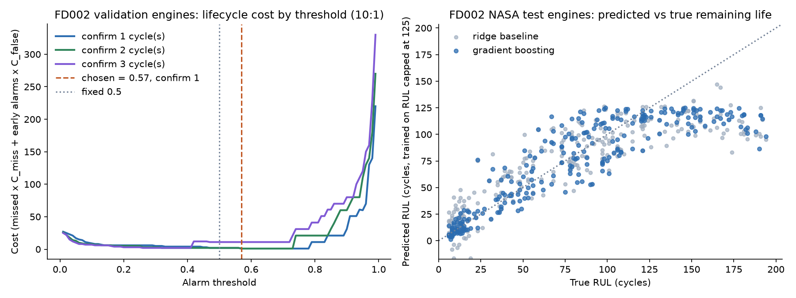

### FD003 (1 operating regime)

Model: **gradient boosting**, the headline model on every subset; logistic regression is the baseline. Engines: 60 fit, 20 validation, 20 lifecycle test, 100 NASA test.

Gradient boosting vs logistic regression ("close" = within 0.01 PR-AUC or 2 cost units):

- Validation PR-AUC: 0.962 vs 0.971 (close)
- NASA test PR-AUC (last cycle): 0.980 vs 0.983 (close)
- Lifecycle test cost, each with its own validation-chosen policy: 1 vs 1 (close)

Alarm policy chosen on validation engines at 10:1: ring when the failure probability is at least **0.31** for **3** consecutive cycle(s).

Lifecycle test: 20 engines run to failure. A good catch rings 10 to 50 cycles before failure. Precision = good catches / alarms that rang; early alarms are the false alarms.

| | Cost-based policy | Fixed 0.5 threshold | Fixed 0.5, same confirm cycles |
|---|---|---|---|
| Threshold | 0.31 | 0.50 | 0.50 |
| Confirm cycles | 3 | 1 | 3 |
| Good catches | 19 | 19 | 20 |
| Early alarms (false alarms) | 1 | 1 | 0 |
| Missed (never rang / too late) | 0 (0 / 0) | 0 (0 / 0) | 0 (0 / 0) |
| Precision | 0.95 | 0.95 | 1.00 |
| Cost | 1 | 1 | 0 |
| Median lead time (cycles) | 26.0 | 28.5 | 25.0 |
| Mean lead time of good catches | 27.2 | 28.4 | 26.7 |

Logistic regression baseline with its own validation-chosen policy (threshold 0.35, confirm 3): cost 1, good catches 19, early alarms 1, missed 0, precision 0.95.

Cost sensitivity (policy re-chosen on validation; cost-based vs fixed 0.5): 5:1 → 1 vs 1; 10:1 → 1 vs 1; 20:1 → 1 vs 1.

Required warning time (policy re-chosen on validation; cost-based vs fixed 0.5, each judged with that warning window): at least 10 cycles → threshold 0.31, confirm 3, cost 1 vs 1; at least 20 cycles → threshold 0.04, confirm 3, cost 3 vs 31; at least 30 cycles → threshold 0.02, confirm 1, cost 18 vs 121.

NASA test benchmark (last recorded cycle of each engine; precision / recall / false alarms):

| Model | PR-AUC (last cycle) | At its chosen threshold | At 0.5 | PR-AUC (all cycles) |
|---|---|---|---|---|
| Gradient boosting | 0.980 | 0.31: 0.89 / 0.85 / 2 | 0.89 / 0.80 / 2 | 0.884 |
| Logistic regression | 0.983 | 0.35: 0.83 / 0.95 / 4 | 0.90 / 0.95 / 2 | 0.870 |

Remaining useful life on NASA test engines (NASA score: lower is better; late predictions cost more):

| Model | RMSE (cycles) | NASA score |
|---|---|---|
| Gradient boosting | 17.7 | 687 |
| Ridge regression | 22.1 | 1,708 |
| Training mean (naive) | 45.1 | 58,161 |

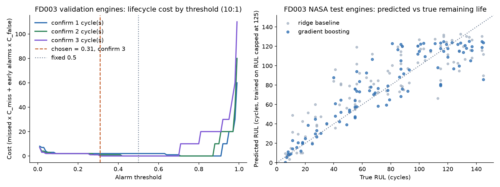

### FD004 (6 operating regimes)

Model: **gradient boosting**, the headline model on every subset; logistic regression is the baseline. Engines: 149 fit, 50 validation, 50 lifecycle test, 248 NASA test.

Gradient boosting vs logistic regression ("close" = within 0.01 PR-AUC or 2 cost units):

- Validation PR-AUC: 0.942 vs 0.919 (boosting better)
- NASA test PR-AUC (last cycle): 0.961 vs 0.940 (boosting better)
- Lifecycle test cost, each with its own validation-chosen policy: 4 vs 4 (close)

Alarm policy chosen on validation engines at 10:1: ring when the failure probability is at least **0.43** for **3** consecutive cycle(s).

Lifecycle test: 50 engines run to failure. A good catch rings 10 to 50 cycles before failure. Precision = good catches / alarms that rang; early alarms are the false alarms.

| | Cost-based policy | Fixed 0.5 threshold | Fixed 0.5, same confirm cycles |
|---|---|---|---|
| Threshold | 0.43 | 0.50 | 0.50 |
| Confirm cycles | 3 | 1 | 3 |
| Good catches | 46 | 44 | 46 |
| Early alarms (false alarms) | 4 | 6 | 4 |
| Missed (never rang / too late) | 0 (0 / 0) | 0 (0 / 0) | 0 (0 / 0) |
| Precision | 0.92 | 0.88 | 0.92 |
| Cost | 4 | 6 | 4 |
| Median lead time (cycles) | 30.5 | 33.0 | 30.0 |
| Mean lead time of good catches | 30.5 | 32.3 | 29.5 |

Logistic regression baseline with its own validation-chosen policy (threshold 0.77, confirm 3): cost 4, good catches 46, early alarms 4, missed 0, precision 0.92.

Cost sensitivity (policy re-chosen on validation; cost-based vs fixed 0.5): 5:1 → 4 vs 6; 10:1 → 4 vs 6; 20:1 → 4 vs 6.

Required warning time (policy re-chosen on validation; cost-based vs fixed 0.5, each judged with that warning window): at least 10 cycles → threshold 0.43, confirm 3, cost 4 vs 6; at least 20 cycles → threshold 0.09, confirm 1, cost 17 vs 16; at least 30 cycles → threshold 0.02, confirm 1, cost 43 vs 176.

NASA test benchmark (last recorded cycle of each engine; precision / recall / false alarms):

| Model | PR-AUC (last cycle) | At its chosen threshold | At 0.5 | PR-AUC (all cycles) |
|---|---|---|---|---|
| Gradient boosting | 0.961 | 0.43: 0.86 / 0.91 / 8 | 0.85 / 0.89 / 8 | 0.756 |
| Logistic regression | 0.940 | 0.77: 0.82 / 0.94 / 11 | 0.78 / 0.98 / 15 | 0.676 |

Remaining useful life on NASA test engines (NASA score: lower is better; late predictions cost more):

| Model | RMSE (cycles) | NASA score |
|---|---|---|
| Gradient boosting | 28.7 | 6,134 |
| Ridge regression | 31.9 | 8,793 |
| Training mean (naive) | 54.8 | 183,013 |

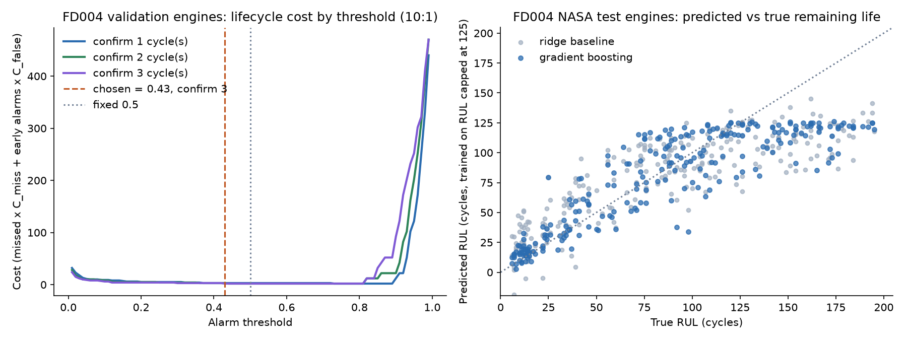

</details>
<!-- RESULTS:END -->

Limitations: the data is simulated; FD003 and FD004 have two fault modes that
the model does not separate; lifecycle test sets are small, so a difference of
one or two engines is noise; an early alarm is assumed to end the engine's run.

## Comparison across datasets

Also saved as `reports/comparison.csv`.

<!-- COMPARISON:START -->
| Dataset | Model | PR-AUC | Precision | Recall | False alarms | Official cost (Scania) | Lifecycle cost (NASA) | RMSE (NASA remaining life) | NASA score |
|---|---|---|---|---|---|---|---|---|---|
| Scania (20% capacity) | Gradient boosting | 0.065 | 0.056 | 0.394 | 953 | 44,467 |  |  |  |
| Scania (20% capacity) | Logistic regression | 0.059 | 0.056 | 0.401 | 952 | 44,002 |  |  |  |
| Scania (20% capacity) | Searched correction | 0.066 | 0.054 | 0.380 | 955 | 45,030 |  |  |  |
| Scania (20% capacity) | Always class 0 |  |  | 0.000 | 0 | 56,100 |  |  |  |
| Scania (unlimited capacity) | Gradient boosting | 0.065 | 0.034 | 0.930 | 3,762 | 43,536 |  |  |  |
| Scania (unlimited capacity) | Logistic regression | 0.059 | 0.035 | 0.873 | 3,385 | 43,756 |  |  |  |
| Scania (unlimited capacity) | Searched correction | 0.066 | 0.039 | 0.669 | 2,359 | 42,594 |  |  |  |
| FD001 | Gradient boosting | 0.937 | 0.913 | 0.840 | 2 |  | 1 | 18.8 | 791 |
| FD001 | Logistic regression | 0.950 | 0.905 | 0.760 | 2 |  | 0 | 22.4 | 1,586 |
| FD002 | Gradient boosting | 0.984 | 0.921 | 0.951 | 5 |  | 3 | 27.5 | 10,275 |
| FD002 | Logistic regression | 0.980 | 0.922 | 0.967 | 5 |  | 1 | 30.1 | 13,157 |
| FD003 | Gradient boosting | 0.980 | 0.895 | 0.850 | 2 |  | 1 | 17.7 | 687 |
| FD003 | Logistic regression | 0.983 | 0.826 | 0.950 | 4 |  | 1 | 22.1 | 1,708 |
| FD004 | Gradient boosting | 0.961 | 0.857 | 0.906 | 8 |  | 4 | 28.7 | 6,134 |
| FD004 | Logistic regression | 0.940 | 0.820 | 0.943 | 11 |  | 4 | 31.9 | 8,793 |

Empty cells, and what each column means:

- **PR-AUC, precision, recall, false alarms.** Scania: the at-risk view (classes 1-4 vs class 0) on test vehicles, first at the recommended workshop capacity (only the riskiest share of vehicles may be flagged), then with unlimited capacity. NASA: the last recorded cycle of each NASA test engine, alerting at the model's validation-chosen threshold. Always class 0 has no score, so no PR-AUC, and never raises an alarm, so precision is undefined.
- **Official cost** uses Scania's cost matrix, which exists only for Scania.
- **Lifecycle cost** needs engines observed all the way to failure. NASA lifecycle test engines are; Scania validation and test vehicles are cut off at a random point, so there is no Scania lifecycle cost.
- **RMSE and NASA score** measure remaining-life predictions. Scania's validation and test labels are classes, not remaining life, so these are NASA only. On NASA rows, the logistic regression row shows the ridge regression baseline for remaining life, and the gradient boosting row shows the gradient boosting regressor.
- Costs are not comparable across datasets: Scania uses the official matrix on 5,045 test vehicles, NASA uses the assumed 10:1 lifecycle cost on 20 to 52 lifecycle test engines.
<!-- COMPARISON:END -->

## Dashboard

`streamlit run streamlit_app.py` opens the dashboard. It reads only `reports/`.

Scania at the recommended workshop capacity, and one vehicle's explanation:

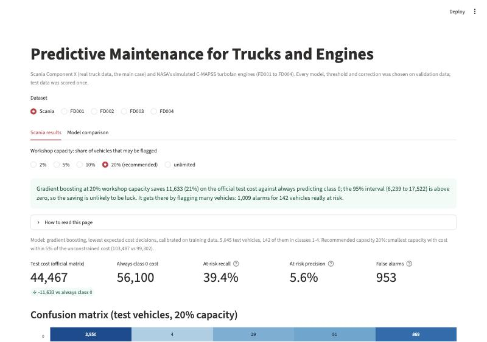

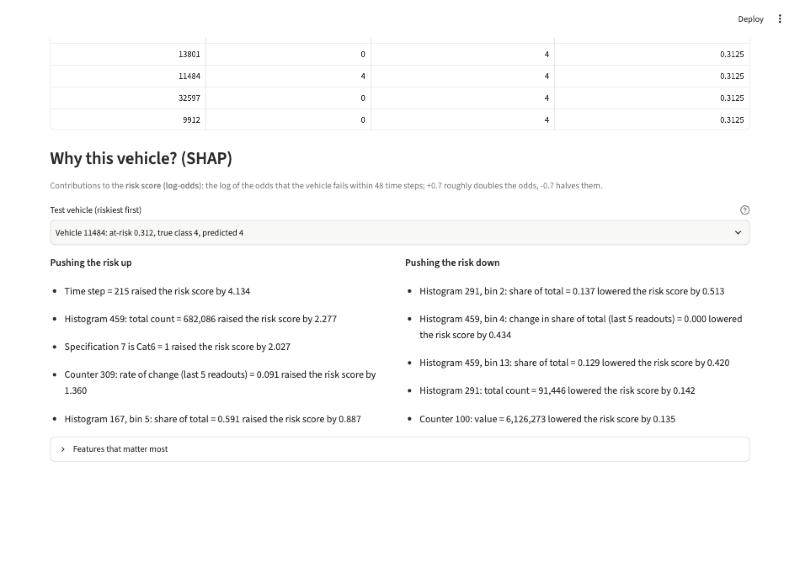

A NASA engine timeline, and the model comparison:

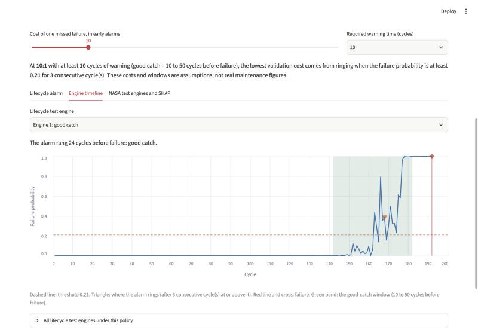

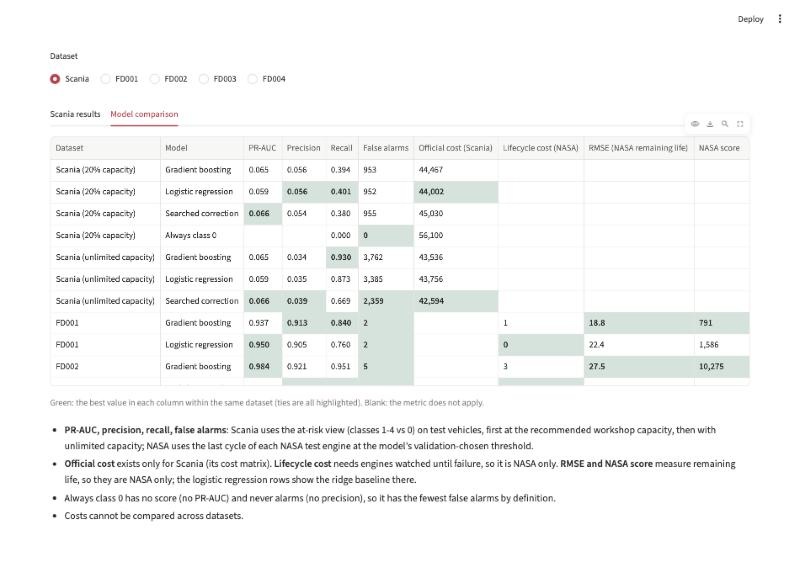

## Run it

Python 3.10 or newer; `requirements.txt` pins the versions the results were
produced with.

```bash
python3 -m venv .venv
source .venv/bin/activate            # Windows: .venv\Scripts\activate
pip install -r requirements-dev.txt  # runtime plus pytest and ruff
```

Put the data in `data/` (see [data/README.md](data/README.md)), then:

```bash
pytest                               # tests on small synthetic data
python -m mfp.scania.pipeline        # Scania: selection, fitting, test scoring, SHAP
python -m mfp.pipeline               # NASA, all four subsets
streamlit run streamlit_app.py       # dashboard
```

Useful options:

- `python -m mfp.scania.selection` reruns only the Scania model comparison; the
  pipeline reuses `reports/scania/selection.json` unless `--select` is given.
- `--no-tune` skips the tuning pass on either pipeline.
- `python -m mfp.pipeline --subset FD001` runs chosen NASA subsets.
- `python -m mfp.scania.pipeline --explain-only` recomputes SHAP from the saved
  model.
- `python -m mfp.report` rebuilds `reports/summary.json`, `reports/comparison.csv`
  and the README results from saved metrics.
- `ruff check .` and `ruff format .` lint and format the code.

## Project structure

```text
├── mfp/
│   ├── config.py        # settings and assumptions for both datasets
│   ├── models.py        # model builders, tuning, NASA score
│   ├── explain.py       # SHAP, readable feature names, summary charts
│   ├── report.py        # summary.json, comparison.csv and README sections
│   ├── dashboard.py     # data logic behind the dashboard
│   ├── scania/
│   │   ├── data.py        # load, validate and cache the CSVs
│   │   ├── labels.py      # classes and censoring
│   │   ├── features.py    # past-only counter, histogram and specification features
│   │   ├── horizons.py    # horizon labels and models, weights, calibration pieces
│   │   ├── selection.py   # simulated validation set and candidate comparison
│   │   ├── evaluate.py    # cost matrix, decision rules, capacity, bootstrap
│   │   └── pipeline.py    # python -m mfp.scania.pipeline
│   ├── data.py, split.py, regimes.py, features.py   # NASA loading and features
│   ├── lifecycle.py     # once-per-engine alarm simulation and policy sweep
│   ├── policy.py        # per-cycle threshold helpers
│   └── pipeline.py      # python -m mfp.pipeline
├── streamlit_app.py     # dashboard
├── tests/               # pytest suite on small synthetic data in the real formats
├── reports/             # every saved result; the dashboard reads only these
├── docs/images/         # dashboard screenshots
├── models/              # trained models (not committed)
└── data/                # raw data (not committed)
```

## Deployment

The dashboard runs from `reports/` alone, without raw data or model files.
`requirements.txt` pins every runtime package to the versions the project was
developed with on **Python 3.14**, so Streamlit Community Cloud should use
Python 3.14 as well.

On Streamlit Community Cloud:

1. Commit the code and `reports/` to GitHub (raw data and models are ignored).
2. Choose **Create app** and select the repository and branch.
3. Set the main file path to `streamlit_app.py`.
4. Under **Advanced settings**, choose **Python 3.14**.
5. Deploy.

## Data credits

- **Scania Component X dataset**: Lindgren, T., Steinert, O., Andersson
  Reyna, O., Kharazian, Z., & Magnússon, S. *SCANIA Component X Dataset: A
  Real-World Multivariate Time Series Dataset for Predictive Maintenance.*
  Scania CV AB. Licence CC BY 4.0. DOI
  [10.5878/bnh5-ka77](https://doi.org/10.5878/bnh5-ka77). Paper:
  [arXiv:2401.15199](https://arxiv.org/abs/2401.15199).
- **NASA C-MAPSS**: Saxena, A., & Goebel, K. (2008). *Turbofan Engine
  Degradation Simulation Data Set.* NASA Prognostics Data Repository, NASA
  Ames Research Center. See also Saxena, A., Goebel, K., Simon, D., & Eklund,
  N. (2008), *Damage Propagation Modeling for Aircraft Engine Run-to-Failure
  Simulation*, PHM 2008.
